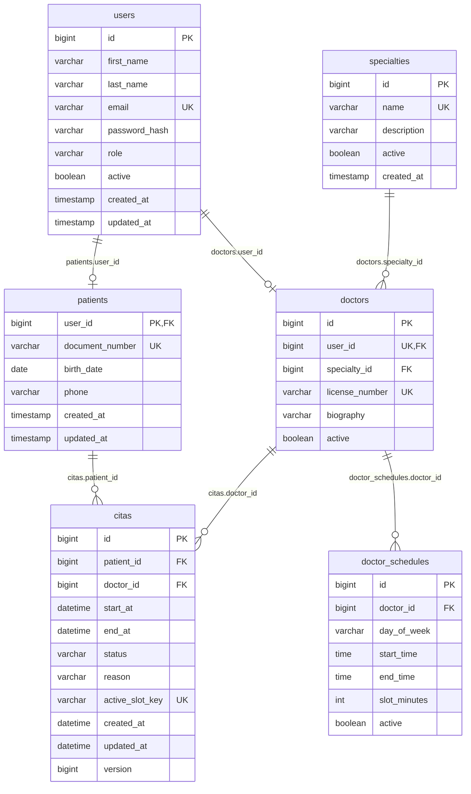

# Base de datos de MediTurno

Las tablas se crean con Flyway desde `src/main/resources/db/migration/`.
Hibernate solo **valida** (`ddl-auto: validate`): si una entidad no coincide con su tabla, la app no arranca.

## Orden de migraciones

| Version | Archivo | Tablas |
|---|---|---|
| V1 | `V1__crear_tabla_usuarios.sql` | `users` |
| V2 | `V2__crear_tabla_pacientes.sql` | `patients` |
| V2_1 | `V2_1__crear_tabla_especialidades.sql` | `specialties` |
| V2_2 | `V2_2__create_doctors_and_schedules.sql` | `doctors`, `doctor_schedules` |
| V3 | `V3__crear_tabla_citas.sql` | `citas` |

Reglas: no cambies una migracion ya aplicada; si necesitas un cambio, crea una version nueva
y pide el numero al integrante 7. Usa SQL portable (las pruebas corren en H2 modo MySQL).

## Diagrama entidad-relacion



Nota: la clave primaria de `patients` es `user_id`, por eso `citas.patient_id` apunta a `patients(user_id)`.

## Configurar la conexion (variables de entorno)

1. Usa `.env.example` como referencia (el `.env` real no se sube a Git).
2. En PowerShell, antes de arrancar:

```powershell
$env:DB_URL = "jdbc:mysql://localhost:3306/mediturno?useSSL=false&allowPublicKeyRetrieval=true&serverTimezone=UTC"
$env:DB_USERNAME = "mediturno"
$env:DB_PASSWORD = "tu-clave"
$env:JWT_SECRET = "tu-secreto-largo"
mvn spring-boot:run
```

Las variables duran solo mientras la ventana de PowerShell este abierta.

## Aiven (MySQL en la nube)

- Usa los datos de conexion de la consola de Aiven (host, puerto, usuario, base).
- SSL es obligatorio: `sslMode=REQUIRED` en `DB_URL`.
- Comparte las credenciales por un canal privado, nunca en Git.
- Primero prueba en MySQL local; aplica a Aiven solo cuando las migraciones esten acordadas.